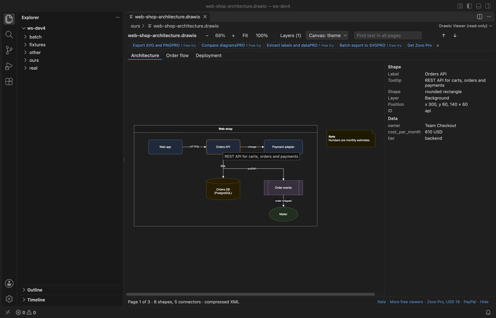

# Drawio Viewer & Preview

Open .drawio and .dio diagrams in VS Code as a read-only view with every page, layers and find. Made by Zovo.

Free, with no account and no network calls:

- Opens .drawio and .dio files read-only: plain or compressed XML, every page, and the shape libraries and icon images that ship with the viewer.
- Page tabs, zoom in and out, Ctrl or Cmd and the wheel to zoom at the pointer, drag to pan, fit to window and 100 %.
- Layers on and off per page. A layer hidden in the file starts hidden.
- Find text in labels, tooltips, links and custom data across all pages, with next and previous.
- Light or dark canvas, or follow your color theme.
- Click a shape or a connector to see its label, tooltip, link (shown as text, never opened), shape, layer, position and custom data.
- A broken or foreign file shows a clear message instead of a blank tab. The file is never changed.

Zovo Pro: USD 19 once, for the Pro tools in every Zovo extension. Each Pro tool has 1 free try on your computer first:

- Export SVG and PNG: the current page or all pages, one SVG and one PNG file per page.
- Compare diagrams: shapes and connectors added, removed and changed (label, style, data, position, ends) page by page, saved as a Markdown report.
- Extract labels and data: every shape and connector of every page with label, tooltip, link, layer, position and custom data, saved as CSV or Markdown.
- Batch export to SVG: every page of every .drawio and .dio file in a folder and its subfolders.

## How to use it

- Click a .drawio or .dio file in the Explorer. It opens in the viewer. Drag to pan, click a shape to read it.
- Keys in the view: + and - zoom, 0 for 100 %, F to fit, PageUp and PageDown for pages, Ctrl+F or Cmd+F to find.
- To try it without your own files, run Drawio Viewer: Open the Sample Diagram from the Command Palette.
- The Pro tools are in the Command Palette (Drawio Viewer: ... (Pro)), in the editor title menu (...) of the viewer, in the Explorer right-click menu of a .drawio or .dio file (Batch export on a folder), and in the small row in the viewer toolbar. The row closes with its x for the rest of the session, and the setting `drawioViewer.showProTools` hides the Pro tools for good.

## What it reads

| File | Notes |
|---|---|
| .drawio, .dio | An `<mxfile>` with one `<diagram>` per page, each page plain XML or compressed (deflate and base64), or a bare `<mxGraphModel>`. |

- Shapes come from the libraries packed with the viewer (general, flowchart, UML, BPMN, network, cloud icon sets and more). A shape from a library that is not packed draws as a plain box.
- Images stored inside the file and the icon images packed with the viewer show. Images on the web are not loaded: they show as a grey placeholder, and the status line counts them.
- Math typesetting is off: a formula shows as its source text. Web fonts are not loaded: the text uses a local font.
- .drawio.svg, .drawio.png, .svg, .png and .xml files are not opened by this extension.

Files up to 100 MB open by default (setting `drawioViewer.maxFileMB`).

## Settings

- `drawioViewer.canvas`: auto, light or dark.
- `drawioViewer.maxFileMB`: the largest file to open.
- `drawioViewer.showProTools`, `drawioViewer.showSupportLinks`, `drawioViewer.askForRating`, `zovo.drawio.trial.enabled`.

## Privacy

The viewer makes no network calls. VS Code reads the file and hands it to the viewer, so it works the same in Remote SSH, WSL and container windows. Nothing is uploaded. A link in a diagram is shown as text and never opened. The only links that leave VS Code are the ones you click: Rate, More free tools, Zovo Pro and the payment pages.

## Also by Zovo

- PlantUML Viewer & Preview, for PlantUML diagrams.
- Graphviz Viewer & DOT Viewer, for DOT graphs.
- BPMN Diagram Editor & Viewer, for BPMN 2.0 process models.

Drawio Viewer & Preview is made by Zovo. MIT License. The diagram view uses the open source viewer library, stencils and shape images from the jgraph/drawio repository (Apache License 2.0), unmodified; see THIRD-PARTY-NOTICES.md.
